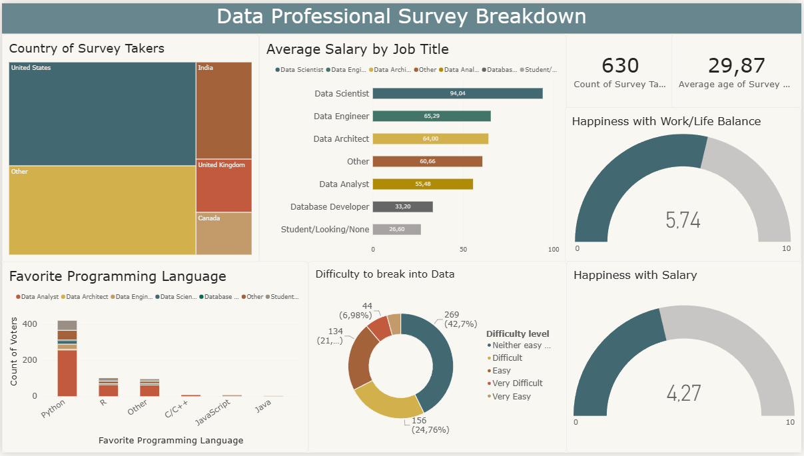

# Data Professional Survey Breakdown – Power BI Dashboard

An interactive Power BI dashboard built on real survey data from data professionals. It shows who answered the survey, how salaries differ by job title, which programming languages are most popular, how hard it was to break into data, and how happy people are with their salary and work/life balance.



---

## Table of Contents

- [Project Overview](#project-overview)
- [Business Questions](#business-questions)
- [Data_Professional_Survey](#dataset)
- [Data Preparation (Power Query)](#data-preparation-power-query)
- [Dashboard Components](#dashboard-components)
- [Key Insights](#key-insights)
- [Tools & Skills](#tools--skills)
- [Repository Structure](#repository-structure)
- [How to Use](#how-to-use)
- [Limitations](#limitations)
- [Credits](#credits)
- [Author](#author)

---

## Project Overview

This is a beginner friendly Power BI project. The raw survey file is cleaned and transformed in **Power Query**, then visualized in a one-page dashboard with a custom theme and color scheme. The goal is to give aspiring data professionals a quick overview of roles, pay, tools and job satisfaction in the field.

## Business Questions

- Where do the survey participants live?
- How does the average salary differ between data job titles?
- Which programming language do data professionals prefer?
- How difficult was it to break into data?
- How happy are professionals with their salary and with their work/life balance?

## Dataset

- **Source:** Data Professional Survey, collected via an online survey shared on LinkedIn, Twitter and other channels (June 2022)
- **Size:** 630 responses
- **Format:** Excel

| Column | Description |
|---|---|
| Unique ID | Anonymous respondent ID |
| Date / Time Taken, Time Spent | Submission date, time and duration |
| Q1 – Current Role | Job title that best fits the respondent (with free-text "Other") |
| Q2 – Switched careers into Data? | Yes / No |
| Q3 – Current Yearly Salary (USD) | Salary range as text, e.g. `106k-125k` |
| Q4 – Industry | Industry the respondent works in |
| Q5 – Favorite Programming Language | Python, R, C/C++, JavaScript, Java, or free-text "Other" |
| Q6 – Happiness (0–10) | Salary, Work/Life Balance, Coworkers, Management, Upward Mobility, Learning New Things |
| Q7 – Difficulty to break into Data | Very Easy to Very Difficult |
| Q8 – Most important factor in a new job | Better Salary, Remote Work, Work/Life Balance, etc. |
| Q9 – Gender | Male / Female |
| Q10 – Current Age | In years |
| Q11 – Country | Country of residence |
| Q12 – Highest Level of Education | High School to PhD |
| Q13 – Ethnicity | Self-reported |

## Data Preparation (Power Query)

All transformations were done in Power Query, so the raw file stays untouched:

1. **Removed unused columns:** Browser, OS, City, Country and Referrer (all empty).
2. **Cleaned job titles (Q1):** Split the column by the delimiter `(` and kept the left part. All free-text answers ("Other (Please Specify): …") collapse into one `Other` category, which leaves seven categories: Data Analyst, Data Architect, Data Engineer, Data Scientist, Database Developer, Student/Looking/None and Other.
3. **Cleaned programming languages (Q5):** Split by the delimiter `:` and kept the left part, so free-text answers (e.g. `Other:SQL`) become `Other`.
4. **Converted salary ranges into a numeric value (Q3):**
   - Duplicated the salary column to keep the original.
   - Split the copy "from digit to non-digit" and removed the letter `K`.
   - Replaced `-` with nothing, and replaced `+` with `225` for the "225k+" group.
   - Created a custom column **Average Salary** = (lower bound + upper bound) / 2, e.g. `106k-125k` becomes 115.5.
   - Changed the data type of Average Salary to decimal number.
5. **Simplified Industry (Q4) and Country (Q11):** Kept the main values and grouped all free-text answers into `Other`.
6. **Applied the changes** with *Close & Apply*.

## Dashboard Components

| Visual | What it shows |
|---|---|
| **Title banner** | "Data Professional Survey Breakdown" |
| **Card – Count of Survey Takers** | 630 respondents |
| **Card – Average Age** | 29.87 years |
| **Treemap – Country of Survey Takers** | Respondents by country (US, India, UK, Canada, Other); clicking a country filters the whole dashboard |
| **Bar chart – Average Salary by Job Title** | Average salary (in thousand USD) per role, using the calculated Average Salary |
| **Stacked column chart – Favorite Programming Language** | Number of voters per language, split by job title |
| **Donut chart – Difficulty to Break into Data** | Share of each difficulty level, with a custom color scale (red = very difficult, blue = very easy) |
| **Gauge – Happiness with Work/Life Balance** | Average rating on a 0–10 scale |
| **Gauge – Happiness with Salary** | Average rating on a 0–10 scale |

## Key Insights

- **The US is the largest group of respondents**, followed by India, the United Kingdom and Canada. Salaries depend strongly on country, which is why the treemap doubles as a filter.
- **Data Scientists earn the most** on average (about 94k USD), ahead of Data Engineers (about 65k) and Data Architects (64k). **Data Analysts average about 55k USD.**
- **Python is the most popular language** by a wide margin, followed by R. Most Python voters are Data Analysts.
- **Breaking into data is seen as moderately hard.** About 43 % answered "neither easy nor difficult" and about 25 % "difficult".
- **Pay is the weakest spot:** happiness with salary averages 4.27 out of 10, compared with 5.74 for work/life balance.

## Tools & Skills

- **Power BI Desktop:** data model, visuals, layout, custom theme
- **Power Query:** data cleaning and transformation
- **DAX / calculated columns:** average salary, averages and counts
- **Excel / CSV:** raw data source
- Dashboard design and data storytelling

## Repository Structure

```
├── data/
│   └── Data_Professional_Survey.xlsx
├── dashboard/
│   └── Data_Professional_Survey.pbix
├── images/
│   └── dashboard.png
└── README.md
```

## How to Use

1. Clone or download this repository.
2. Open the `.pbix` file in [Power BI Desktop](https://powerbi.microsoft.com/desktop/) (free).
3. If prompted, update the data source path to the Excel file in the `data/` folder (*Home > Transform data > Data source settings*).
4. Click on the visuals (e.g. a country in the treemap) to filter the dashboard interactively.

## Limitations

- The survey is a **self-selected sample** (shared on social media), so it may not represent all data professionals.
- **Salaries were reported as ranges.** The average salary is the midpoint of each range, so it is an estimate, not an exact value.
- Free-text answers (job titles, languages, countries, industries) were **grouped into "Other"** instead of being fully standardized. For example, SQL answers fall into "Other" for programming language.
- Most respondents are Data Analysts, so averages for other roles rest on fewer responses.
- Salaries are in **US dollars** and do not account for cost of living in different countries.
- The data is from **2022**.

## Credits

The dataset and the project idea come from the **Power BI tutorial series by Alex the Analyst** (final project). Data cleaning, dashboard build and theme were done by me following the course.

## Author

**Angel Mary Sarammal**
Data Analyst | M.Sc. Data Science

- LinkedIn: (https://www.linkedin.com/in/angel-mary-e-s-5a4808248/)
- GitHub: [angy711](https://github.com/)
